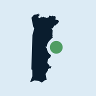
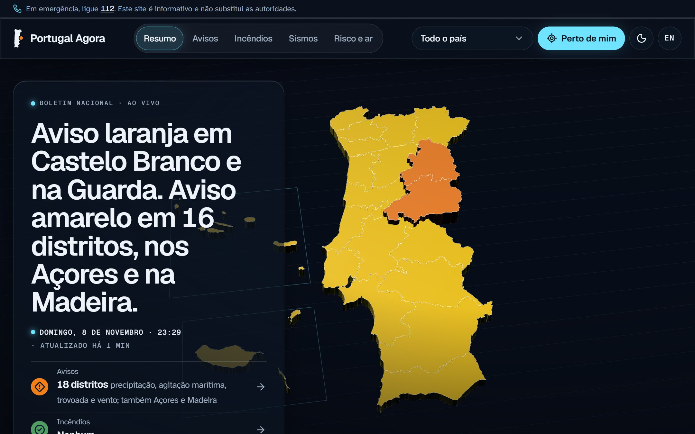
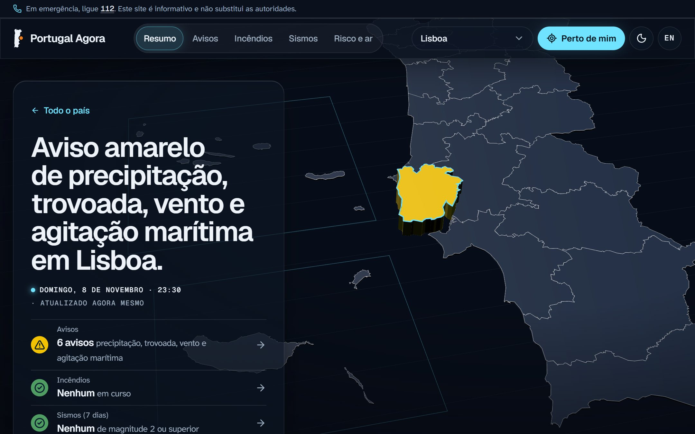
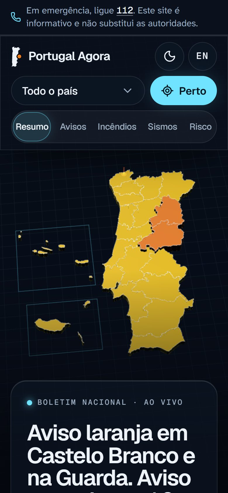
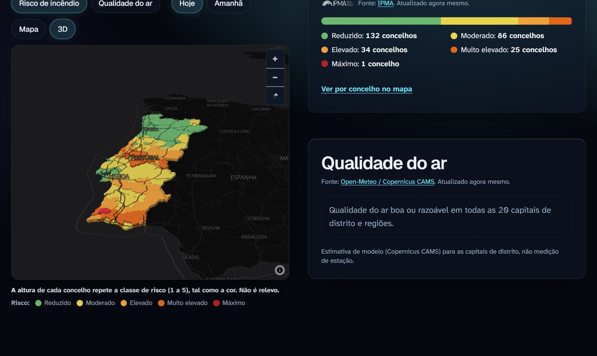

<div align="center">

<a href="https://portugalagora.pt"></a>

# Portugal Agora

**Está tudo bem no meu distrito?** Avisos, incêndios, sismos, risco de incêndio e qualidade do ar em Portugal, num só sítio e com dados oficiais.

[**portugalagora.pt**](https://portugalagora.pt) · [English](https://portugalagora.pt/en) · [Fontes](https://portugalagora.pt/fontes) · [Sobre](https://portugalagora.pt/sobre)

[](https://github.com/bernardopaulino/portugal-agora/actions/workflows/ci.yml)
[](LICENSE)
[](#acessibilidade)
[](#princípios)

<br>

<a href="https://portugalagora.pt"></a>

</div>

## O que é

O Portugal Agora junta o que o IPMA, a Proteção Civil (via Fogos.pt), o Copernicus e a DGT publicam e responde em segundos a uma pergunta simples: **como está Portugal agora?** A primeira coisa que se lê é uma frase ("Aviso laranja em Castelo Branco e na Guarda."), não uma tabela. O detalhe fica a um toque: por tema, por distrito (18 + Açores + Madeira) e por concelho (308).

Os dados atualizam-se sozinhos a cada minuto, o site funciona sem rede com os últimos dados guardados e, se uma fonte falhar, diz-o em vez de ficar em branco.

> [!IMPORTANT]
> O Portugal Agora é informativo e não substitui as autoridades. **Em emergência, ligue 112.**

## O que mostra

|                              |                                                                                                      |
| ---------------------------- | ---------------------------------------------------------------------------------------------------- |
| ⚠️ **Avisos meteorológicos** | Nível oficial do IPMA por distrito, histórico de 7 dias, notificações push e RSS                     |
| 🔥 **Incêndios**             | Ocorrências ativas da ANEPC, no mapa 2D ou sobre o relevo em 3D                                      |
| 🌍 **Sismos**                | Últimos 7 dias no continente, Açores e Madeira, cada sismo à sua profundidade num bloco 3D da crosta |
| 🌲 **Risco de incêndio**     | Por concelho, hoje e amanhã, com a altura de cada concelho a repetir a classe de risco               |
| 🌬️ **Qualidade do ar e UV**  | Estimativa Copernicus CAMS nas capitais de distrito e índice UV do IPMA                              |
| 🌦️ **Tempo e mar**           | Previsão a 5 dias, observação na estação mais próxima e estado do mar nos distritos com costa        |
| 📍 **Perto de mim**          | A localização passa a distrito e concelho **no próprio dispositivo**; nada é enviado ao servidor     |

<table>
  <tr>
    <td width="68%"></td>
    <td width="32%" rowspan="2"></td>
  </tr>
  <tr>
    <td></td>
  </tr>
</table>

A lista completa, com todos os pormenores, está em [docs/FUNCIONALIDADES.md](docs/FUNCIONALIDADES.md).

## Princípios

- **Sem fins lucrativos.** Sem publicidade, sem donativos, sem monetização de qualquer tipo. É uma condição dos termos de utilização do Fogos.pt e do IPMA e não deve ser alterada.
- **Oficial e honesto.** Cada número diz de onde vem e de quando é. O nível principal segue sempre a escala oficial do IPMA (verde, amarelo, laranja, vermelho).
- **Calmo, não alarmista.** Resumo primeiro, detalhe a pedido. O movimento acontece uma vez e depois fica quieto; nada pisca nem anda em loop.
- **Privado por omissão.** Sem rastreio; a localização nunca sai do dispositivo. Ver [/privacidade](https://portugalagora.pt/privacidade).

### Acessibilidade

WCAG 2.2 AA, verificado com axe em cada build. Letra Atkinson Hyperlegible Next (desenhada para baixa visão) com base de 18 px, níveis que nunca dependem só da cor (cor + ícone + palavra), alvos de toque de 44 px, temas claro e escuro, respeito por "reduzir movimento" e mapa plano quando não há WebGL. Testado de 320 px a 1920 px. Em português e em inglês.

## Fontes de dados

| Dados                                  | Fonte                                                                                               | Atualização |
| -------------------------------------- | --------------------------------------------------------------------------------------------------- | ----------- |
| Avisos meteorológicos                  | [IPMA](https://api.ipma.pt)                                                                         | 5 min       |
| Sismos (continente, Madeira, Açores)   | IPMA                                                                                                | 5 min       |
| Risco de incêndio rural por concelho   | IPMA (só continente)                                                                                | 1 h         |
| Índice UV e previsão a 5 dias          | IPMA                                                                                                | 1 h         |
| Tempo observado (estações)             | IPMA (estação mais próxima da capital de cada distrito)                                             | 20 min      |
| Estado do mar (12 pontos da costa)     | IPMA (hoje e os 2 dias seguintes)                                                                   | 1 h         |
| Incêndios ativos                       | [Fogos.pt](https://fogos.pt) (dados ANEPC), requer chave                                            | 2 min       |
| Qualidade do ar (estimativa de modelo) | [Open-Meteo](https://open-meteo.com) / Copernicus CAMS, CC BY 4.0                                   | 10 min      |
| Mapa base                              | [OpenFreeMap](https://openfreemap.org), © OpenStreetMap                                             | —           |
| Relevo (vista 3D dos incêndios)        | [Mapterhorn](https://mapterhorn.com) (DGT, IGP, Copernicus GLO-30)                                  | —           |
| Limites de distritos e concelhos       | CAOP 2025, [DGT](https://www.dgterritorio.gov.pt), CC BY; concelhos das ilhas: OpenStreetMap (ODbL) | estático    |

A página [/fontes](https://portugalagora.pt/fontes) explica cada fonte e como classificamos incêndios, sismos e qualidade do ar.

## Como funciona

As APIs externas nunca são chamadas pelo browser. O servidor agrega todas as fontes com uma cache própria para cada uma (de 2 min a 1 h), valida cada resposta com Zod, normaliza-a para um modelo comum e guarda no Redis o último resultado bom. Se uma fonte falhar, o site mostra esse resultado assinalado como desatualizado. As páginas são estáticas e o browser vai buscar o estado a `/api/state` a cada minuto.

**Stack:** Next.js 16 (App Router, Cache Components), React 19, TypeScript, Tailwind CSS 4, MapLibre GL, three + @react-three/fiber, SWR, Zod, Upstash Redis, Vitest, Playwright + axe-core. Alojado na Vercel (Paris).

Mais em [docs/ARQUITETURA.md](docs/ARQUITETURA.md): fluxo dos dados, idiomas, estrutura das pastas e como regenerar os limites administrativos e o índice do relevo.

## Desenvolvimento

Requisitos: Node.js 24 (ver `.nvmrc`).

```bash
npm install                  # também copia o worker do MapLibre para public/maplibre
cp .env.example .env.local   # preencher CONTACT_EMAIL (e FOGOS_API_KEY, se a tiver)
npm run dev                  # http://localhost:3000 (inglês em /en)
```

Sem `FOGOS_API_KEY`, a secção de incêndios mostra "indisponível" e remete para o fogos.pt. Sem Redis, os snapshots ficam em memória. O Redis aceita `KV_REST_API_URL`/`KV_REST_API_TOKEN` (criadas pela integração da Vercel) ou `UPSTASH_REDIS_REST_URL`/`UPSTASH_REDIS_REST_TOKEN`.

| Comando                             | O que faz                                       |
| ----------------------------------- | ----------------------------------------------- |
| `npm run dev`                       | servidor de desenvolvimento                     |
| `npm run check`                     | lint + tipos + formatação + testes unitários    |
| `npm test`                          | testes unitários (Vitest)                       |
| `npm run build && npm run test:e2e` | testes end-to-end e acessibilidade (Playwright) |
| `npm run format`                    | formata o código (Prettier)                     |

Na primeira vez que correres os testes e2e: `npx playwright install chromium`.

O CI (GitHub Actions) corre `npm run check`, o build e os testes e2e em cada push para `main` e em cada pull request. Para pôr o site em produção (Vercel, Redis, notificações, tarefas agendadas), ver [docs/OPERACAO.md](docs/OPERACAO.md).

## Contribuir

Encontrou um erro, um dado errado ou uma frase pouco clara? [Abra uma issue](https://github.com/bernardopaulino/portugal-agora/issues/new/choose). Pull requests são bem-vindos; ver [CONTRIBUTING.md](CONTRIBUTING.md). Para problemas de segurança, ver [SECURITY.md](SECURITY.md).

## In English

Portugal Agora ("Portugal Now") is a non-profit site that answers _"is everything OK in my district?"_ in seconds. It brings together official weather warnings, earthquakes, fire risk, UV and forecasts from IPMA, active wildfires from Fogos.pt (ANEPC), air quality from Copernicus CAMS and boundaries from DGT, for the whole country, its 20 districts and 308 municipalities. It is accessible (WCAG 2.2 AA), works offline, keeps your location on your device and is available in Portuguese and English at [portugalagora.pt/en](https://portugalagora.pt/en). The code and documentation are in Portuguese.

## Licença

Código: [MIT](LICENSE). Os dados pertencem às respetivas fontes e seguem os seus termos de utilização.
